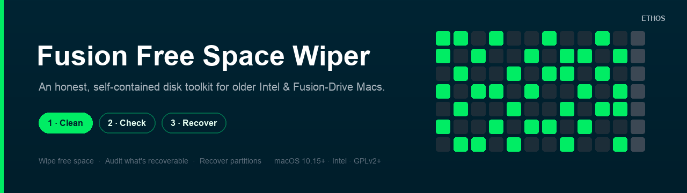

# Fusion Free Space Wiper

<div align="center">



<br><br>

[](https://github.com/ssharaf-dot/fusion-free-space-wiper/releases/latest)
[](https://github.com/ssharaf-dot/fusion-free-space-wiper/releases)
[](LICENSE)


### ⬇︎ [**Download the latest version**](https://github.com/ssharaf-dot/fusion-free-space-wiper/releases/latest)

*Open the `.dmg` → drag the app to **Applications** → right‑click ▸ **Open** on first launch.*

</div>

---

## Overwrite free space on an older Intel Mac

Fusion Free Space Wiper is a free, open-source macOS app by Sunaz Sharaf under the
Ethos brand. It is built for older Intel Macs with a hard drive or Fusion Drive,
including a Late-2012 iMac running macOS Catalina, and for external HDDs.

If you are looking for a way to wipe free space on a Mac without deleting current
files, **Clean** overwrites accessible free space so previously-deleted files are
harder to recover. This is not a certified, forensic, or "secure" erase and cannot
guarantee that deleted data is unrecoverable.

The sidebar has three tools:

1. **Clean** — overwrite the **empty (free) space** on a disk so previously‑deleted files are
   harder to recover, without touching your current files.
2. **Check** — run the bundled **PhotoRec** (read‑only) to see **what's still recoverable**.
3. **Recover** — analyse and recover **partitions** with the bundled **TestDisk**.

Everything is **self-contained in one DMG**, with PhotoRec and TestDisk bundled.
It was made for macOS Catalina after Apple removed the easy built-in way to
overwrite free space. The app requires macOS 10.15 Catalina or newer and an Intel
Mac; it also runs on Apple Silicon via Rosetta, where pure SSD storage gives
free-space wiping limited value.

> An [Ethos](https://github.com/ssharaf-dot) tool. No network. No telemetry. Local only.
> Bundles **PhotoRec & TestDisk** © CGSecurity (GPL).

---

## What free-space wiping can and cannot do

This performs an **accessible free‑space overwrite**. It is **not** a certified, forensic,
or "secure" erase, and it **cannot guarantee** that previously‑deleted data is unrecoverable
— especially on SSD/Fusion storage (wear‑leveling, over‑provisioning, TRIM, and APFS
snapshots put some data out of reach). Provided **as‑is, with no warranty** (see
[LICENSE](LICENSE)). Keep a backup. The best fit is HDD storage or an older Fusion
Drive, with important limits on the SSD portion of a Fusion Drive. On pure SSD
storage, prefer FileVault for ongoing protection or a full erase when handing
off the Mac. Neither is an erasure guarantee from this app.
**"No files recovered" is not proof that nothing is recoverable.**

## Which Macs benefit?

| Your drive | Does this help? |
|---|---|
| **Spinning hard drive (HDD)** | Best fit for overwriting accessible free space; no recovery guarantee |
| **Fusion Drive (HDD + SSD)** | Useful mainly for the HDD portion; SSD limitations still apply |
| **Pure SSD / flash** | Limited value; prefer FileVault or a full erase |

Full machine cheat‑sheet: **[COMPATIBILITY.md](COMPATIBILITY.md)**.

## Download and open

1. Download from **[Releases](https://github.com/ssharaf-dot/fusion-free-space-wiper/releases/latest)**.
2. Open the `.dmg`, drag **Fusion Free Space Wiper** to **Applications**.
3. First launch: ad‑hoc signed (not notarized), so **right‑click ▸ Open ▸ Open** once.

**Requirements:** macOS 10.15 Catalina or newer, Intel Mac (runs on Apple Silicon under
Rosetta, but those are all‑SSD — see the compatibility note).

## Common questions about wiping free space on a Mac

### Can I wipe free space on macOS Catalina?

This app supports macOS 10.15 Catalina or newer on Intel Macs. Its Clean tool
overwrites accessible free space without touching current files. It cannot
guarantee that previously-deleted data is unrecoverable.

### Does Clean delete my current files?

Clean targets empty, free space rather than current files. This describes Clean;
the Recover tool is a separate workflow for analysing and recovering partitions.

### Can I use it before selling an iMac with a Fusion Drive?

It can overwrite accessible free space on an older Fusion iMac, but it does not
remove current files or guarantee that deleted data cannot be recovered. Free-space
wiping alone is not a complete handoff process. Follow the steps appropriate to
erasing the Mac before sale, rather than treating a completed wipe or Check result
as proof that it is ready to hand over.

### Is free-space wiping useful on an SSD?

It has limited value on pure SSD storage. Wear-leveling, over-provisioning, TRIM,
and APFS snapshots can put data beyond the reach of a free-space overwrite.
Fusion Drives also have an SSD component, so those limitations apply there too.
Prefer FileVault for ongoing protection or a full erase when handing off an SSD Mac.

### Does PhotoRec finding no files prove the drive is clean?

No. Check uses the bundled PhotoRec to read the source disk and see what it can
recover. **"No files recovered" is not proof that nothing is recoverable.**
It is not a certificate or a forensic guarantee.

### Is the app free and open source?

Yes. Fusion Free Space Wiper uses the GNU GPL v2 or later and bundles PhotoRec
and TestDisk © CGSecurity under the GPL. The app has no network access and no
telemetry. It is provided as-is, with no warranty.

## Start with a test

The app opens on **Clean**. Run the **100 MB safety test** first — it exercises the *real*
engine (same writing, flushing, progress, cleanup) but stops after a strict limit, so you can
confirm everything works before a full wipe.

## Build from source

Needs the Xcode Command Line Tools (no full Xcode required).

```bash
./build.sh        # builds build/…app and dist/FusionFreeSpaceWiper-<ver>.dmg (x86_64, 10.15)
./run_tests.sh    # 40 automated tests, incl. a real-engine run on a disposable disk image
```

You can also open the folder in Xcode (it reads `Package.swift`).

## Credits & acknowledgements

Bundles **TestDisk & PhotoRec** by **Christophe Grenier / CGSecurity** — the long‑standing
free, open‑source standard for data recovery.

- Project home: https://www.cgsecurity.org/wiki/TestDisk
- Source & downloads: https://www.cgsecurity.org/wiki/TestDisk_Download
- GitHub mirror: https://github.com/cgsecurity/testdisk

Redistributed **unmodified** under the GPL v2+. See [THIRD-PARTY-NOTICES.md](THIRD-PARTY-NOTICES.md).

## License

**GNU GPL v2 or later** ([LICENSE](LICENSE)) © 2026 Sunaz Sharaf. Because this app bundles
PhotoRec/TestDisk (GPL), the combined work is distributed under the GPL. No warranty.

